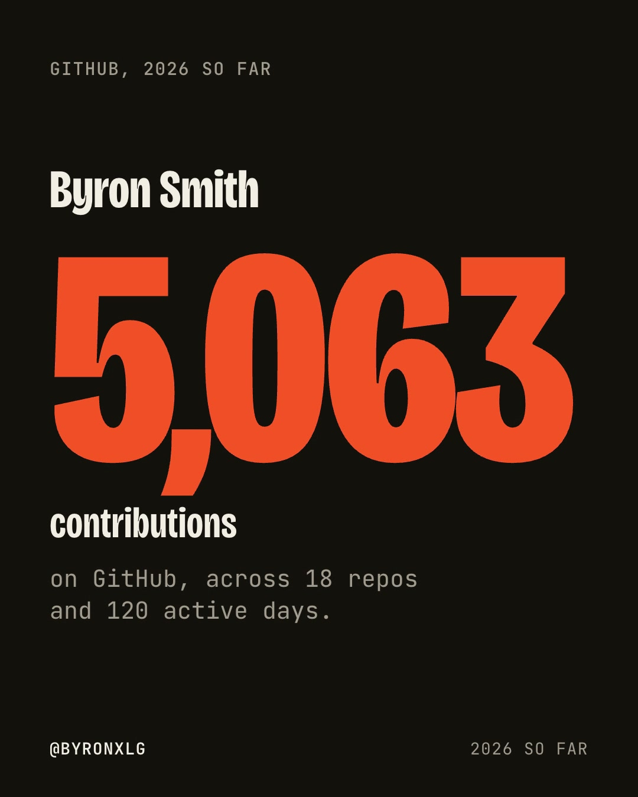

# github-year-in-review

A Claude Code skill that turns a GitHub user's year into a 45-second video made for LinkedIn:
4:5, readable with the sound off, honest about bots and private repos, and ending on who you
were this year instead of a pile of totals.

Rendered with HyperFrames (`npx hyperframes`); no other skill needed.



Example: [examples/byronxlg-2026.mp4](examples/byronxlg-2026.mp4) (79 s, 1080x1350, 2.4 MB).
Thumbnail: [examples/byronxlg-2026-thumbnail.png](examples/byronxlg-2026-thumbnail.png).

## What the film shows

Three chapter cards (the rhythm, the work, what shipped) type the shell command that would
answer that section (`git log --since=...`, `git shortlog -sn`, `git tag`); beats carry the
section name only. Nothing is numbered: no slide counter, hash label, part numbers or progress
ticks. The last frame has no label or rail.

Always there:

1. Your name and the year's contribution count.
2. The year as a grid, one square per day, with the loudest month boxed.
3. Your longest streak, active days, and weekend share.
4. The hour you commit most, and your latest-night commit.
5. The projects that took the time.
6. Pull requests merged, rendered as `+` lines of a diff.
7. Repos you started, and stars they earned this year.
8. An archetype ("The Weekend Orchestrator") with the reason in one line.
9. The year grid again, your handle, and a call to make yours.

Optional, only when the data is there:

- **Shipped with a team**: the share of your commits co-written with coding agents, and which
  ones (Claude, Copilot, Codex, Cursor, Devin, Aider, Jules, Gemini, Amp, OpenHands), read from
  `Co-authored-by` trailers, "Generated with" footers, agent bot authors and agent branch
  prefixes (`claude/`, `codex/`). Shows when at least 10 sampled commits and 5% are signed.
- **The biggest change**: your largest merged PR as a diff stat (`+80,807 -40`) over the
  year's lines added and removed. Needs a nameable PR of 300+ lines.
- **Lines changed**: the year's lines added and removed in merged PRs, drawn against a famous
  codebase on the same scale ("about twice the Quake III Arena source"). 1,000+ lines added.
- **Machine time**: GitHub Actions minutes on your own repos, by month, and as days. 60+ minutes.
- **Shipped to users**: releases tagged on your repos, first to latest version. 3+ releases.
- **Open source**: PRs merged into other people's public projects. 3+ PRs.
- **One more thing**: your automation, or your busiest day (when the agents beat is absent).

Beats with thin data drop out, so a quiet year makes a shorter film rather than an empty one.
Design and research: [docs/design.md](docs/design.md), [docs/research.md](docs/research.md).

## Install

With [skillfold](https://github.com/byronxlg/skillfold):

```bash
skillfold add github:byronxlg/github-year-in-review/skills/github-year-in-review -g
```

Or copy `skills/github-year-in-review/` into `~/.claude/skills/`.

Needs: `gh` (authenticated), Python 3.9+, Node 18+ (`npx hyperframes`), ffmpeg. The
HyperFrames skills (`hyperframes-core`, `hyperframes-cli`) help the agent with check and render.

## Use

In Claude Code: `/github-year-in-review` (your account, this year), or
`/github-year-in-review --user octocat --year 2025`.

The scripts also run on their own:

```bash
S=skills/github-year-in-review/scripts
python3 $S/collect.py --user octocat --year 2025 --out out/year.json
python3 $S/build.py out/year.json --out out            # writes out/story.json and out/composition/
cd out/composition && npx hyperframes check && npx hyperframes render --output ../year-in-review.mp4
cd .. && npx hyperframes snapshot thumbnail --at 0.5 --no-end -o thumbnail/shots \
  && cp thumbnail/shots/frame-00-at-0.5s.png thumbnail.png   # 1080x1350 cover, no chrome
```

Outputs: `year-in-review.mp4` (1080x1350), `thumbnail.png` (1080x1350, the identity as a cover:
"The Weekend Orchestrator" and the stats behind it, without counters, rail or CTA; upload it as LinkedIn's custom video thumbnail), `poster.jpg`
(frame 0, baked into the video), `share-copy.txt`.

## Privacy and honesty

- Private repositories count toward totals but are never named unless `--include-private`.
- Repos where most commits share one message template (a cron committing as you) are reported as
  automation and kept out of the rhythm stats.
- Partial years are labelled "so far".
- Agent numbers are lower bounds: only signed commits count, a commit that merely mentions an
  agent does not, and dependency bots (Dependabot, Renovate) are neither you nor an agent.
- The film caps at about 70 s (v3 pacing: one thing moves at a time, then a 3 s hold); when too many beats qualify, the least important drop first.

## Music

No music ships with this repo; bring a track you can post. With `--music`, the build detects
beats with `npx hyperframes beats` and starts scenes on the beat. Without a track the film is
silent, which suits LinkedIn's muted autoplay.

## Tests

```bash
python3 -m unittest discover -s tests
```

MIT. Fonts (Bricolage Grotesque, JetBrains Mono) are SIL OFL.
